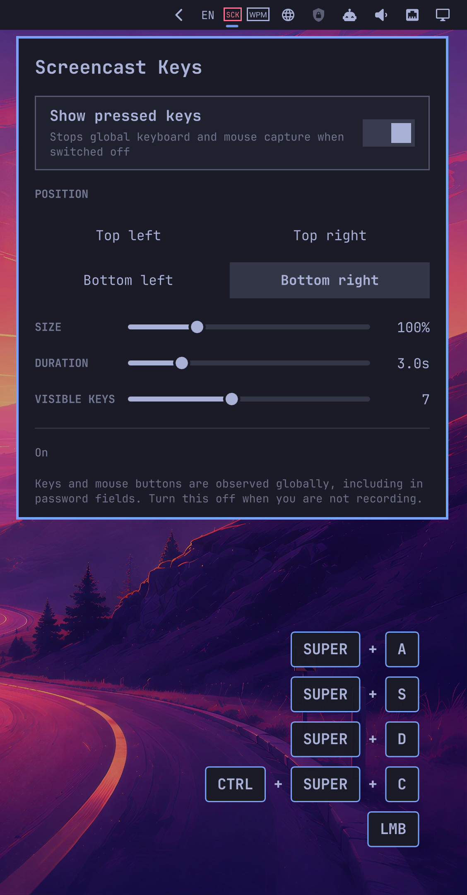

# Omarchy Screencast Keys

An Omarchy Shell plugin by LeoMoon Studios that displays pressed keys on a passive, click-through corner surface. Keyboard and mouse-button chords are shown as individual rounded keycaps, such as `[SUPER] + [L]` or `[SUPER] + [RMB]`. Up to the configured number of entries (seven by default) are kept on screen and each fades out after the configured duration.

Requires Omarchy 4.0 or newer. Other desktops and standalone Quickshell configurations are not supported.

## Preview



## Features

- Four positions: top-left, top-right, bottom-left, and bottom-right
- Overall size control from 60% to 200%
- Display duration control from 1 to 10 seconds, defaulting to 3 seconds
- Visible stack size control from 1 to 15 entries, defaulting to 7
- Left, middle, and right mouse buttons shown as LMB, MMB, and RMB
- On/off switch that stops input capture without removing the bar icon
- Optional hotkeys-only mode that hides single keys and mouse buttons while retaining keyboard and mouse combinations
- Capture defaults to off when settings are missing or malformed
- Capture is automatically disabled when Omarchy locks the screen, including idle locks
- Capture stays off after unlock until manually enabled again
- Theme-aware Omarchy keycaps on every monitor
- A keep-loaded service owns capture, settings, history, and one fixed-size surface per monitor
- Key history remains visible above fullscreen applications without shortcut-specific lifecycle workarounds
- No key history or captured text is written to disk

## Install

Install and enable the plugin from GitHub with:

```bash
omarchy plugin add https://github.com/leomoon-studios/omarchy-screencast-keys.git --enable
```

Omarchy installs the repository into:

```text
~/.config/omarchy/plugins/leomoon-studios.omarchy-screencast-keys/
```

The widget defaults to the right section of the bar. It can be moved with the normal Omarchy bar controls.

The plugin stores preferences at:

```text
~/.config/leomoon-studios.omarchy-screencast-keys/settings.json
```

## Removal

Unload the plugin and remove its installed checkout:

```bash
omarchy plugin remove leomoon-studios.omarchy-screencast-keys --yes
```

Omarchy intentionally leaves the plugin's settings in place so they remain available after a reinstall. To permanently remove those settings too:

```bash
rm -rf ~/.config/leomoon-studios.omarchy-screencast-keys
```

## Input access

Wayland does not let an ordinary client observe keys typed into other apps. The plugin's bundled reader therefore opens Linux keyboard and pointer event devices read-only using access already available to the Omarchy session. It never uses `wtype`, `ydotool`, or another input-injection mechanism. The plugin does not request elevated privileges or install udev rules. If only some input devices are readable, the menu reports **On with partial input access**; if none are readable, it reports **Global input access unavailable** without changing the system.

Capture starts disabled on a fresh installation and remains disabled if the settings file is missing or malformed.

The reader sends key and mouse-button labels only to the running Omarchy Shell process. It does not create a log or store key history. Global capture can still observe keys entered into password fields, so switch the plugin off whenever it is not needed.

## Architecture

The enabled Omarchy service remains loaded independently of the bar widget. It
owns the input reader, settings, in-memory key history, expiry timer, and one
fixed-size `PanelWindow` per monitor. Each surface maps only while history is
visible, stays keyboard-passive and click-through, and never resizes in
response to key insertion, displacement, fading, or removal.

The surfaces use Wayland's overlay layer so they can remain visible above
fullscreen applications. `SUPER+F` and other global shortcuts follow the same
capture and display path as ordinary chords; there are no shortcut-specific
visibility, timer, model, or surface lifecycle hooks.

## Controls

- Left-click the SCK badge to open settings.
- Right-click the icon to quickly turn capture on or off.
- Use the hotkeys-only toggle, monitor selector, position buttons, size slider,
  duration slider, and visible-keys slider in the settings popup. The monitor
  selector appears when more than one display is connected and can target all
  monitors or one display by connector name.
- The popup stays open while global shortcuts are pressed, making it possible
  to include the menu in a screenshot or recording. Click outside it or click
  the badge again to close it.
- Omarchy's `SUPER+CTRL+1` through `SUPER+CTRL+9` shortcuts can open it by its
  numbered position among panel-capable icons in the bar's right section.

## Test and validate

```bash
omarchy plugin validate .
python3 -m unittest discover -s tests -v
python3 scripts/key-reader.py --demo
```

The `demo` IPC method previews the key surface without input permission:

```bash
omarchy-shell leomoon-studios.omarchy-screencast-keys demo
```

## Compatibility

Omarchy 4.0+ on Wayland is the only supported environment.

Version 1 displays physical Linux key-code labels. Letter and punctuation labels therefore follow the standard physical layout rather than translating through the currently selected keyboard layout.
